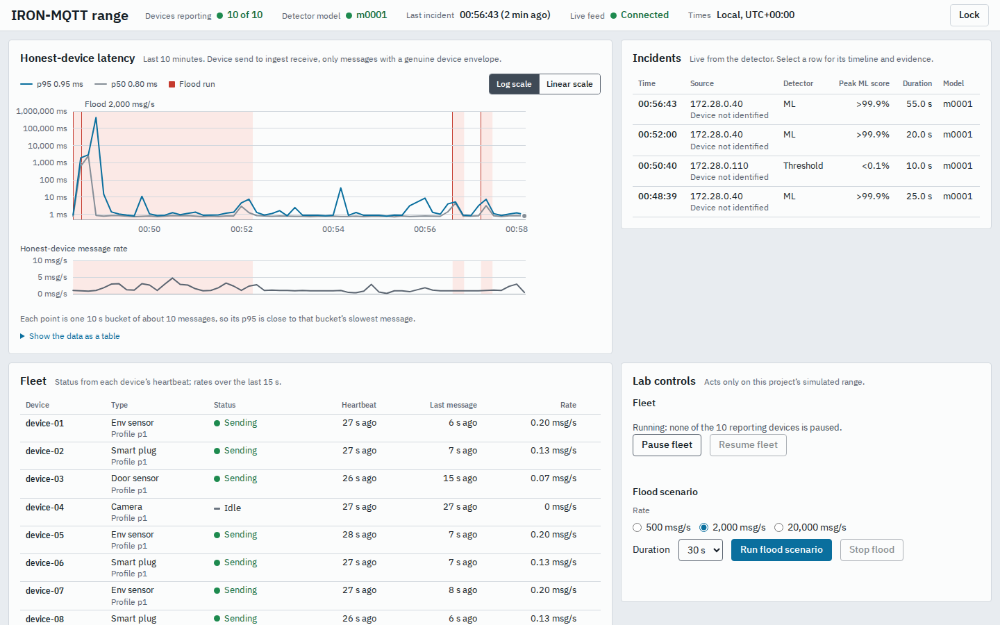
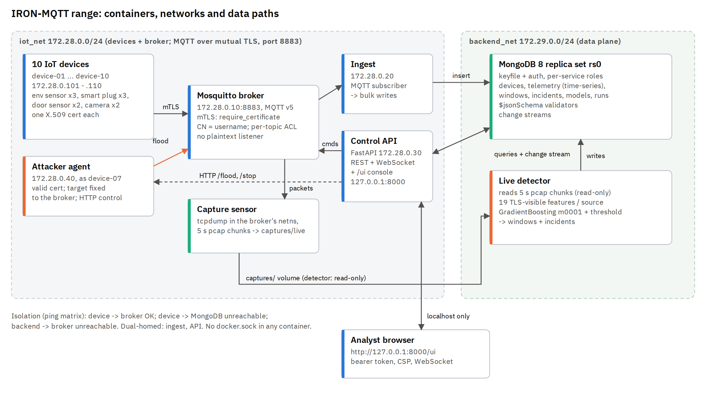
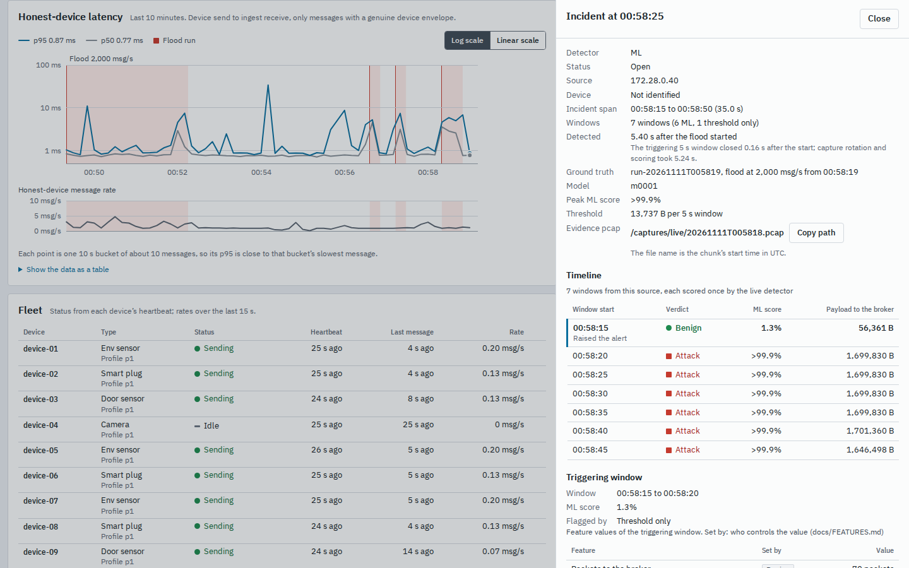
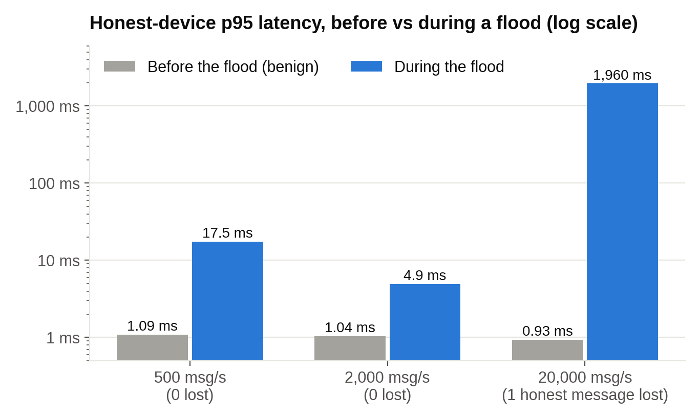
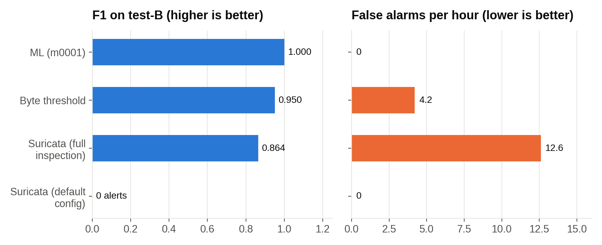
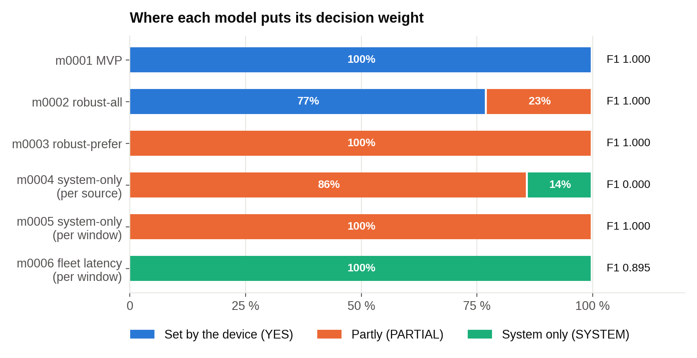

<div align="center">

# 🛡️ IRON-MQTT

**A self-contained IoT security range: attack it, detect it, measure it.**

Ten simulated IoT devices speaking real MQTT over mutual TLS, a packet sensor, a MongoDB data plane,
a live machine-learning intrusion detector and a FastAPI control plane, all in Docker on one laptop.
An insider with a valid certificate floods the broker; the range measures the harm and compares how
a supervised model, a threshold rule and Suricata catch it on fully encrypted traffic.




</div>

---

## ✨ Highlights

| | |
|---|---|
| 🔐 **Real device identity** | One X.509 certificate per device (ECDSA P-256). Mosquitto requires it, uses its CN as the MQTT username, and a per-topic ACL stops a device from publishing as another. No plaintext port. |
| 🚨 **Insider attack, measured** | A compromised device with a valid certificate and the genuine client software floods its own topic. At 20,000 msg/s the honest devices' p95 latency goes from **0.93 ms to 1,960 ms**. |
| 🕵️ **Detection on encrypted traffic** | 19 TLS-visible features per source per 5 s window, a gradient-boosting model trained and tested on separate runs: **F1 1.000, 0 false alarms/hour**. |
| 🦺 **Honest baselines** | Same windows for every detector: byte threshold F1 0.950 (4.2 false alarms/h); **Suricata with its default TLS setting raises 0 alerts**, and 0.864 with full inspection. |
| ⚡ **Live pipeline** | Capture → features → score → MongoDB → change stream → WebSocket. Incidents reach the browser in **9.1 ms**; detection measured against ground truth (**5.4–6.8 s** after flood start). |
| 🧪 **Robustness analysis** | Every feature is classified by who controls it. Robust models cut reliance on attacker-controlled features from 100 % to 0 % without losing detection, and the analysis shows where that stops working. |
| ✅ **Tested against the live range** | `./iron test` runs **45 tests** against the running services: mTLS and ACLs, MongoDB validation and roles, API auth, WebSocket auth, console security, detector logic. |

---

## 🏗️ Architecture



| Component | What it does |
|---|---|
| **Devices** (`services/device`) | 10 containers, one IP and certificate each: 3 env sensors (every 5 s), 3 smart plugs (10 s), 2 door sensors (Poisson events), 2 cameras (bursts). Retained status, Last Will, 60 s heartbeat, remote commands. |
| **Broker** (`broker/`) | Mosquitto 2, MQTT v5, mutual TLS only, identity-based topic ACL. |
| **Capture sensor** | tcpdump in the broker's network namespace, rotating 5 s pcap chunks. |
| **Ingest** (`services/ingest`) | Subscribes with a persistent session, tracks per-boot sequence numbers, bulk-writes telemetry. |
| **MongoDB 8** (`services/common/db.py`) | Replica set with keyfile auth, one least-privilege role per service, `$jsonSchema` validators, time-series telemetry with TTL. |
| **Detector** (`services/detector`, `ids/`) | Scores every completed window with the active model and a threshold; deduplicated incidents with evidence pcap and ground-truth latency. |
| **Control API + console** (`services/api`) | FastAPI REST + OpenAPI, bearer auth, WebSocket with first-message auth fed by a change stream; static console under a strict CSP. |
| **Attacker agent** (`services/attacker`) | Floods as a compromised device. Its target is hard-fixed to the range's broker and it refuses any other host. |

Devices can reach the broker but **not** the database: MongoDB lives on a separate network, and only ingest and the API are attached to both (`./iron ping-matrix` proves it).

---

## 🚀 Quick start

**Requirements:** Docker with Compose v2 (Linux, macOS, or Windows with WSL2), `bash`, `openssl` and `python3` (standard library only). Everything runs locally on CPU.

```bash
git clone https://github.com/wissem-ben-khalifa/iron-mqtt.git
cd iron-mqtt
git config core.hooksPath scripts/git-hooks   # optional: blocks committing secrets, pcaps, datasets

./iron up      # creates .env, the PKI and the Mongo keyfile, builds the images, starts the range
./iron test    # 45 tests against the running range
```

`./iron up` generates random passwords and an API token into `.env` (mode 600) and never prints them.

### Train the detector

A fresh range has no model yet: the detector waits (and restarts) until one is registered. Record a labelled run and train on it:

```bash
./iron experiment --name train-A --warmup 90 --attacks 800:90,4000:90 --gap 30 --cooldown 75
./iron train --runs train-A        # registers model m0001 in MongoDB; the detector picks it up
```

### Open the console

```bash
grep API_TOKEN .env      # the token the console asks for
```

- Console: <http://127.0.0.1:8000/ui>, with the lab controls to pause the fleet or run a flood scenario
- API docs (Swagger): <http://127.0.0.1:8000/docs>
- Live incidents: `ws://127.0.0.1:8000/ws/incidents`, authenticated by a first message `{"type": "auth", "token": "..."}`



---

## 🔬 Reproduce the experiments

Every number in [`docs/RESULTS.md`](docs/RESULTS.md) comes from one of these commands.

| Command | What it measures |
|---|---|
| `./iron test-broker` | mTLS and ACL: valid cert, no cert (alert 116), foreign CA (alert 48), plaintext refused, cross-device publish denied |
| `./iron fleet-check --seconds 300` | every device heard, loss, rate vs profile, end-to-end latency |
| `./iron ingest-check --seconds 150` | wire vs database: every message stored exactly once |
| `./iron ping-matrix` | network isolation between the device and data planes |
| `./iron capture-check` | evidence pcaps: rogue handshake, alerts, keylog decryption |
| `./iron attack-check --rate 20000 --duration 30` | flood impact on honest devices (latency, loss) |
| `./iron experiment ...` then `./iron train` / `./iron evaluate --model m0001 --train train-A --test test-B` | offline IDS on separate train/test runs vs threshold |
| `./iron suricata` | Suricata 8 rules fitted on train-A, run on test-B (default and full TLS inspection) |
| `./iron detector-check` | live detection rate, latency and false alarms |
| `./iron robust` | robust-feature models and feature provenance |
| `./iron transfer` | transfer between the fleet and the public MQTTset dataset (download it into `data/mqttset/`) |

The held-out run uses a different fleet seed and an attack rate never seen in training:

```bash
DEVICES=10 ./iron gen-devices --seed 2 && ./iron up
./iron experiment --name test-B --warmup 75 --attacks 2000:90 --cooldown 55
./iron gen-devices --seed 1 && ./iron up       # back to the default fleet
```

---

## 📊 Results at a glance

<table>
<tr>
<td width="50%"></td>
<td width="50%"></td>
</tr>
<tr>
<td><b>Harm.</b> The flood is a telemetry-pipeline denial of service: the single ingest consumer saturates (~100 % of one core) and honest data arrives ~2 s late at 20,000 msg/s. Freshness dies before availability.</td>
<td><b>Detection.</b> Everyone catches the flood once they inspect it; the difference is false alarms. A default Suricata deployment stops inspecting encrypted flows and stays silent.</td>
</tr>
</table>



**Robustness.** For a volumetric flood, volume is both the signal and the thing the attacker controls. Attributing the attack to a source needs per-source volume; the only fully system-level signal (honest-device latency) detects that an attack is happening, but 5 s later and without saying who. Details in [`docs/RESULTS.md`](docs/RESULTS.md) and [`docs/FEATURES.md`](docs/FEATURES.md).

---

## 🗂️ Repository layout

```text
iron                  task runner: ./iron help lists every task
compose.yaml          broker, sensor, mongo, ingest, detector, api, attacker, tests
compose.devices.yaml  the device fleet (generated by scripts/gen_devices.py)
Dockerfile            one shared, digest-pinned Python 3.12 image for all services
broker/               mosquitto.conf (mTLS only) and the topic ACL
pki/make_certs.sh     range CA, broker, device, service and rogue certificates
services/
  device/             behaviour profiles and the MQTT device client
  ingest/             MQTT -> MongoDB with loss tracking
  detector/           live scoring and incident logic
  api/                FastAPI control plane and the console (ui/)
  attacker/           compromised-device flood agent (target fixed to the broker)
  common/             MQTT/TLS client, MongoDB schema, validators, indexes
  dbinit/             replica set, roles and users bootstrap
ids/                  features, labelling, training, evaluation, Suricata comparison, robust models
scripts/              experiments, checks, evidence capture, git hooks
suricata/iron.rules   generated Suricata rules (with provenance)
tests/                tests that run against the live range
docs/                 RESULTS.md, FEATURES.md, results summary served by the API
```

---

## 🔒 Security notes

- Attacks only ever target this simulated fleet: the attacker refuses any broker host other than the range's own.
- The API listens on `127.0.0.1` only and never mounts the Docker socket; it commands devices over MQTT.
- Secrets (`.env`, `secrets/`, `certs/`) and captures are generated locally and git-ignored. TLS keylogs decrypt captured sessions, so they are treated as secrets. The optional pre-commit hook enforces all of this.
- The console renders API data as text only, under `default-src 'none'; script-src 'self'`; the token lives in `sessionStorage`, and the WebSocket token never appears in a URL.

## 🧭 Limitations and roadmap

- The insider flood is easy to catch; the model's advantage here is fewer false alarms. Next: low-rate and slow-ramp floods.
- Data poisoning through detector self-training is designed (model lineage is stored in MongoDB) but not built yet.
- Single-node replica set and a single ingest consumer, which is the measured bottleneck at 20,000 msg/s.
- One shared API token without roles; the API is meant for local use.
- MQTT only; a CoAP/DTLS device type is a natural extension.

## 📄 License

[MIT](LICENSE)
